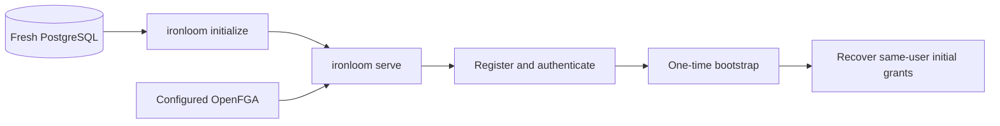

# النشر

تفتح الخدمة الحالية تثبيت PostgreSQL ونقطة OpenFGA الحاليين المحددين. لا تنشئ قاعدة بديلة عند الفشل. ما زالت الخدمات المضمنة والإدارة المحلية قيد التنفيذ؛ هذا الربط لا يكمل خطة النشر.

قبل بدء Deployment، جهز قاعدة PostgreSQL الجديدة المختارة وخدمة OpenFGA، ثم شغّل `ironloom initialize` مرة واحدة مع `IRONLOOM_DATABASE_URL` و`IRONLOOM_INSTALLER_TOKEN`. ينشئ مخطط Ironloom جديدًا فقط ويرفض الموجود. يستخدم التشغيل العادي `ironloom serve` مع التثبيت نفسه. يقتصر استرداد التهيئة على المسؤول المسجل نفسه ولا يستبدل الحساب أو يعيد منحة ألغيت بعد الاكتمال.

يقرأ المخطط `IRONLOOM_DATABASE_URL` من `database.existingSecret` / `database.urlKey` (الافتراضي `ironloom-database` / `database-url`). اضبط `openfga.url` على النقطة الفعلية المصرح بها؛ يوفر `openfga.existingSecret` / `openfga.tokenKey` الرمز اختياريًا. العنوان الافتراضي اسم يحتاج إلى ضبط وليس خدمة OpenFGA مضمنة بعد. أبق الاتصالات خاصة واحم النقل البعيد.

وفر `IRONLOOM_CONFIG_KEY` في سر الإعداد، وهو مفتاح 32 بايت بترميز base64. يُستهلك الرمز الأولي عند التهيئة المصادقة وليس كلمة مرور مسؤول قابلة لإعادة الاستخدام. يستخدم إنشاء الحساب مسار التسجيل. اضبط `runtime.publicUrl` مع مسار النشر وحدودًا موجبة صريحة في `download.maxFileBytes` / `download.maxTransferBytes`.

تصيير المخطط لا ينشر ولا يؤهل الاستدلال. افصل جذور الاستمرارية ومالكيها. لا تحذف PVC أو تعيد ضبط التثبيت لتجاوز أخطاء الاتصال أو المصادقة.

يوفر المسار العام الآن الإعداد والتعليمات وحالة المحادثات وسجلها وSSE القابل للإعادة. يلزم `Last-Event-ID`؛ ويرسل تجاوز المخزن `ironloom.error` لإعادة المزامنة. لا يؤدي قطع النقل إلى إلغاء التنفيذ. اضبط هوية `IRONLOOM_NODE_ID` الثابتة وجذري `IRONLOOM_PROJECTS_ROOT` و`IRONLOOM_MODELS_ROOT` المطلقين والمنفصلين؛ يوفر Helm وحدات تخزين دائمة منفصلة. لا تزال المحولات والعزل والتبعيات المدارة والتنفيذ الكامل قيد التطوير.
