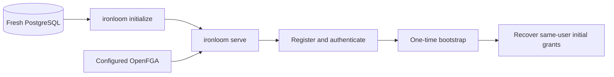

# Despliegue

El servicio actual abre la instalación PostgreSQL existente y el endpoint OpenFGA configurados. No crea una base de reemplazo cuando falla. Los servicios incluidos y la gestión nativa siguen en implementación; este cableado no completa el plan de despliegue.

Antes de iniciar el Deployment, prepare la base PostgreSQL nueva seleccionada y OpenFGA; ejecute `ironloom initialize` una vez con `IRONLOOM_DATABASE_URL` e `IRONLOOM_INSTALLER_TOKEN`. Solo crea un esquema Ironloom nuevo y rechaza uno existente. Los reinicios usan `ironloom serve` y la misma instalación. La recuperación de permisos iniciales conserva al mismo administrador; no reemplaza la cuenta ni restaura permisos revocados después de completarse.

El chart lee `IRONLOOM_DATABASE_URL` desde `database.existingSecret` / `database.urlKey` (por defecto `ironloom-database` / `database-url`). Configure `openfga.url` con el endpoint real autorizado; `openfga.existingSecret` / `openfga.tokenKey` proporcionan opcionalmente su token. El endpoint predeterminado es un nombre por configurar, no un despliegue OpenFGA incluido todavía. Mantenga conexiones privadas y proteja el transporte remoto.

Proporcione `IRONLOOM_CONFIG_KEY` mediante el secreto de configuración: base64 de 32 bytes. El token inicial se consume al establecer el administrador autenticado; no es una contraseña reutilizable. El registro de cuentas usa la ruta de autenticación. Configure `runtime.publicUrl` con su ruta base y límites positivos explícitos `download.maxFileBytes` / `download.maxTransferBytes`.

Renderizar el chart no despliega ni valida inferencia. Mantenga separados los directorios persistentes y sus propietarios. No borre PVC ni reinicie datos para eludir fallos de conexión o autenticación.
