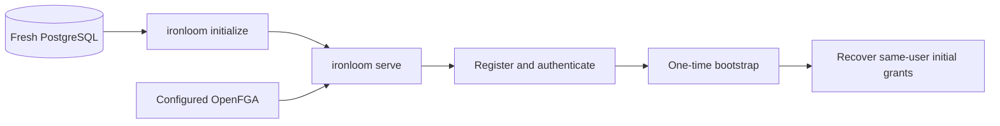

# Deployment

The current service opens the configured existing PostgreSQL installation and OpenFGA endpoint. It does not create a replacement database on failure. Bundled PostgreSQL/OpenFGA services and managed native lifecycle are still being implemented; this connection-wiring increment is not the complete deployment plan.

Before starting the Deployment, provision its selected fresh PostgreSQL database and current OpenFGA service, then run `ironloom initialize` once with `IRONLOOM_DATABASE_URL` and `IRONLOOM_INSTALLER_TOKEN`. This explicitly initializes only a fresh Ironloom schema and rejects an existing one. A normal restart uses `ironloom serve` and reopens the same installation. Grant initialization can recover for the same persisted bootstrap administrator; it cannot replace that account or restore a deliberately revoked grant after completion.

The chart reads `IRONLOOM_DATABASE_URL` from `database.existingSecret` / `database.urlKey` (defaults: `ironloom-database` / `database-url`). Set `openfga.url` to the actual authorized service endpoint; optional `openfga.existingSecret` / `openfga.tokenKey` supply its service token. The chart default endpoint is a name to configure, not an included OpenFGA deployment yet. Keep both connections private and use transport protection for remote connections.

Provide `IRONLOOM_CONFIG_KEY` through the existing setup secret: it is base64-encoded 32-byte key material. The installer token is consumed by initial authenticated bootstrap, not a reusable setup/admin password. Initial account provisioning uses the auth registration route. Service sessions remain separate from provider credentials. Configure `runtime.publicUrl` including its deployment base path, and explicit positive `download.maxFileBytes` / `download.maxTransferBytes`.

No deployment or inference qualification is performed by rendering the chart. Persistent project/model/database roots and their owners must remain distinct. Do not delete PVCs or reset an installation to work around connectivity or authentication failures.

The service now mounts configuration, instructions, conversation state/history and replayable SSE beneath the public deployment path. SSE requires `Last-Event-ID`; reader overflow emits `ironloom.error` and requires resynchronization. Disconnects and transport shutdown do not cancel execution. Set the stable `IRONLOOM_NODE_ID` and separate absolute `IRONLOOM_PROJECTS_ROOT` / `IRONLOOM_MODELS_ROOT`; Helm provides separate persistent claims. Adapter/sandbox registration, bundled dependency lifecycle and complete execution remain in progress.

Linux command containment now uses a dedicated helper, bubblewrap namespaces, explicit descriptor-bound writable paths and seccomp. Host paths and Git/service metadata are not writable; enforcement failures never run the command. Native Linux functional tests cover isolation, symlink rejection and descendant cleanup. The container installs bubblewrap/Git with UID/GID 1000. Full fenced workflow wiring, Alpine execution qualification and Mac/GPU work remain separate and unfinished.
