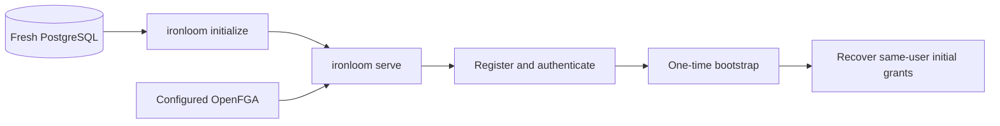

# परिनियोजन

वर्तमान सेवा चुनी गई मौजूदा PostgreSQL स्थापना और OpenFGA endpoint खोलती है। विफलता पर प्रतिस्थापन डेटाबेस नहीं बनता। शामिल सेवाएँ और प्रबंधित स्थानीय जीवनचक्र अभी लागू हो रहे हैं; यह कनेक्शन वायरिंग पूरी परिनियोजन योजना नहीं है।

Deployment शुरू करने से पहले चुना गया नया PostgreSQL डेटाबेस और OpenFGA तैयार करें; फिर `IRONLOOM_DATABASE_URL` तथा `IRONLOOM_INSTALLER_TOKEN` के साथ एक बार `ironloom initialize` चलाएँ। यह केवल नया Ironloom स्कीमा बनाता है और मौजूदा स्कीमा अस्वीकार करता है। सामान्य पुनः आरंभ `ironloom serve` से वही स्थापना खोलता है। प्रारंभिक अनुमति की पुनर्प्राप्ति केवल उसी सहेजे हुए प्रशासक के लिए है; खाता नहीं बदलेगा और पूर्ण होने के बाद हटाई गई अनुमति वापस नहीं मिलेगी।

Chart `database.existingSecret` / `database.urlKey` से `IRONLOOM_DATABASE_URL` लेता है (डिफ़ॉल्ट `ironloom-database` / `database-url`)। `openfga.url` को वास्तविक अधिकृत endpoint पर सेट करें; वैकल्पिक `openfga.existingSecret` / `openfga.tokenKey` उसका टोकन देते हैं। डिफ़ॉल्ट endpoint अभी शामिल OpenFGA सेवा नहीं है; उसे कॉन्फ़िगर करें। कनेक्शन निजी रखें और दूरस्थ परिवहन सुरक्षित करें।

मौजूदा setup secret में base64 में 32 बाइट का `IRONLOOM_CONFIG_KEY` दें। प्रारंभिक टोकन प्रमाणित bootstrap में एक बार खर्च होता है; यह पुनः उपयोग योग्य प्रशासक पासवर्ड नहीं है। खाते auth registration मार्ग से बनते हैं। आधार पथ वाला `runtime.publicUrl` और स्पष्ट धनात्मक `download.maxFileBytes` / `download.maxTransferBytes` सेट करें।

Chart रेंडर करने से परिनियोजन या inference qualification नहीं होती। स्थायी मूल और उनके मालिक अलग रखें। कनेक्शन या प्रमाणीकरण त्रुटि से बचने के लिए PVC न हटाएँ और स्थापना रीसेट न करें।

सेवा अब सार्वजनिक पथ पर कॉन्फ़िगरेशन, निर्देश, वार्तालाप इतिहास और पुनः चल सकने वाला SSE प्रदान करती है। SSE के लिए `Last-Event-ID` आवश्यक है; बफ़र भरने पर `ironloom.error` पुनः समन्वयन बताता है। कनेक्शन बंद होना निष्पादन रद्द नहीं करता। स्थिर `IRONLOOM_NODE_ID` और अलग पूर्ण पथ `IRONLOOM_PROJECTS_ROOT` / `IRONLOOM_MODELS_ROOT` दें; Helm अलग स्थायी वॉल्यूम देता है। अडैप्टर, सैंडबॉक्स, प्रबंधित निर्भरताएँ और पूर्ण निष्पादन अभी जारी हैं।

Linux कमांड अलगाव अब अलग सहायक प्रक्रिया, bubblewrap नेमस्पेस, स्पष्ट लेखन पथ और seccomp का उपयोग करता है। अलगाव विफल होने पर कमांड नहीं चलता। नेटिव परीक्षण अलगाव, सिमलिंक अस्वीकृति और चाइल्ड प्रक्रिया सफ़ाई जाँचते हैं। कंटेनर में bubblewrap/Git और UID/GID 1000 हैं। पूर्ण वर्कफ़्लो, Alpine निष्पादन सत्यापन और Mac/GPU कार्य अभी अधूरे हैं।
