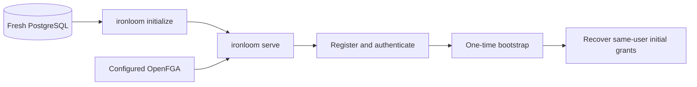

# 部署

当前服务打开已配置的现有 PostgreSQL 安装和 OpenFGA 端点。故障时不会创建替代数据库。随附数据库服务和本地托管生命周期仍在实现中；本次连接配置并未完成整个部署计划。

启动 Deployment 前，准备选定的全新 PostgreSQL 数据库和当前 OpenFGA 服务，使用 `IRONLOOM_DATABASE_URL` 和 `IRONLOOM_INSTALLER_TOKEN` 运行一次 `ironloom initialize`。它仅创建全新的 Ironloom 模式并拒绝已有模式。正常重启使用 `ironloom serve` 打开同一安装。初始授权恢复仅限已记录的同一管理员，不会替换账户，也不会在完成后恢复被明确撤销的授权。

Chart 从 `database.existingSecret` / `database.urlKey` 读取 `IRONLOOM_DATABASE_URL`（默认为 `ironloom-database` / `database-url`）。将 `openfga.url` 设置为实际获准端点，可通过 `openfga.existingSecret` / `openfga.tokenKey` 提供服务令牌。默认端点名称需要配置，目前尚未随附 OpenFGA 部署。连接保持私有，远程连接必须保护传输。

通过现有配置 Secret 提供 `IRONLOOM_CONFIG_KEY`，值为 base64 编码的 32 字节密钥。安装令牌在首次认证引导时消耗，不是可重复使用的管理员密码。普通账户通过认证注册路由创建。配置包含部署基础路径的 `runtime.publicUrl`，以及明确的正数 `download.maxFileBytes` / `download.maxTransferBytes`。

渲染 Chart 不会部署服务或验证推理。项目、模型和数据库的持久化根目录及所有者保持独立。不要通过删除 PVC 或重置安装来绕过连接或认证失败。

服务现在在公开部署路径下提供配置、指令、会话状态、历史和可重放 SSE。SSE 要求 `Last-Event-ID`；缓冲区溢出时发送 `ironloom.error` 并要求重新同步。断开连接或关闭传输不会取消执行。请配置稳定的 `IRONLOOM_NODE_ID` 和独立的绝对路径 `IRONLOOM_PROJECTS_ROOT` / `IRONLOOM_MODELS_ROOT`；Helm 提供独立持久卷。适配器、沙箱、托管依赖和完整执行仍在开发中。
